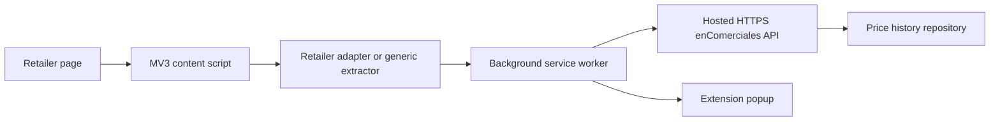

# enComerciales browser extension architecture

## Scope

The browser extension reads product details from supported retailer pages and requests product matches and price history from the hosted enComerciales API. Its manifest declares HTTPS access only to `encomerciales.com` and `www.encomerciales.com`. This repository contains the browser extension and the PHP integration for the existing hosted application; it does not include a local CSV API or the production database.

## Runtime architecture

The browser never connects directly to the database. Product extraction records its method, and the popup only presents historical data returned by the API with a match result.

## API contract

`GET /api/products/search?name=&sku=&gtin=&limit=5` returns product match candidates.

`GET /api/products/history?id=` returns the matched product, price statistics, and history.

`GET /api/products/compare` returns the hosted service's product comparison response.

Price observation uploads are disabled in the shipped extension.

## Security and deployment notes

The extension contains no credentials. The production API must use HTTPS, a strict CORS origin allowlist, prepared SQL statements, and structured errors that do not expose secrets. See [production deployment](browser-extension/PRODUCTION_DEPLOYMENT.md) and [security](browser-extension/SECURITY.md).
