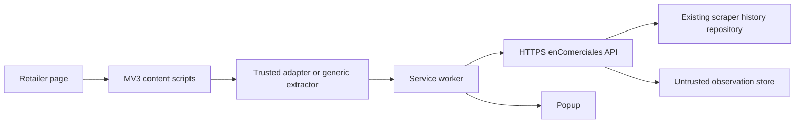

# enComerciales browser extension audit and architecture

## Audit (2026-10-08)

The available scraper project is `/home/neto/codex/enComerciales/eC_scraperFull`. It is a Python 3.11+ HTTP scraper using BeautifulSoup and pandas. Supported stores are Alianza, Vinoteca, La Europea, Palacio de Hierro, La Castellana, and Liverpool. Each scraper writes a CSV with `Tipo`, `Nombre`, `Links`, `Anterior`, `Precios`, `Fecha`, `Tienda`, `Disponibilidad`, `Moneda`, `AnteriorNumerico`, and `PrecioNumerico`. The separate PHP application under the Windows project copy provides the production MariaDB connection and `ec_raw_reportdata` table; the Phase 1.1 PHP API reuses that connection at deployment time.

The scraper project itself has no MariaDB connection, but the separately located PHP application has a mysqli connection in `scripts/connect.php`, configuration in `config/ec_config.php`, and historical rows in `ec_raw_reportdata`. The PHP application has existing admin authentication but no public extension API. Product identifiers are not explicit in the table: the normalized product name and product URL are the practical current identifiers. Store identifiers are the `Tienda`/`store` value. Existing matching logic is limited to scraper pagination de-duplication (including Castellana product IDs); there is no cross-retailer matching.

The extension does not alter scraper behavior. `api/server.py` is a development adapter over existing CSV snapshots, while `api/php/` is the production adapter over the existing MariaDB application connection. Both preserve the same browser-facing contract.

## Runtime architecture

The browser never connects to MariaDB. Product extraction is marked with its method; generic extraction is not presented as adapter-trusted. Matching returns `EXACT`, `HIGH`, `MEDIUM`, `LOW`, or `UNKNOWN`, and the popup only displays history after an API match.

## API contract

`GET /api/products/search?name=&sku=&gtin=&limit=5` returns `{products:[{id,name,retailer,matchConfidence}]}`.

`GET /api/products/history?id=` returns `{stats,history}`. Stats may be null when no observations exist.

`GET /api/products/compare?id=` returns the same product search shape in the development adapter; production should return retailer-level latest prices.

`POST /api/prices/observe` accepts validated product, retailer, URL, price, currency, extraction method, and match confidence fields. It is labeled `BROWSER_EXTENSION` and is never merged into trusted scraper history automatically.

## Security and deployment notes

The shipped extension contains no credentials. Development defaults to localhost and production URL is configured in Options. Production must serve HTTPS, allow only the deployed extension origin in CORS, validate retailer URLs against an allowlist, authenticate observations if accounts are introduced, and use prepared SQL statements. The current project has no auth mechanism to reuse, so production authentication remains an integration task.
