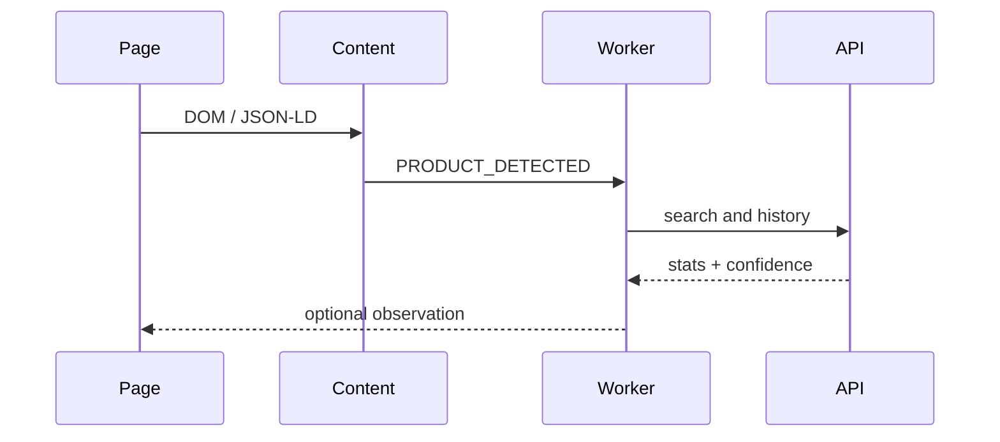

# Developer guide

The extension uses Manifest V3: `content/` detects and extracts, `stores/adapters.js` holds independent selectors, `background/` is the service worker, `utils/` contains parsing/matching/API/rating logic, and `popup/` renders the small UI. Content scripts send only extracted product data; the popup makes API requests through the worker-compatible shared utility.

To add a store, define its domain and selectors in `stores/adapters.js`, keep selectors scoped to that store, add a fixture, and test name/price extraction. Generic extraction remains the fallback. Do not turn a fuzzy match into `EXACT`; only identifiers such as equal GTIN/SKU justify that level.

Run JavaScript syntax checks with `node --check` on non-module scripts or load the unpacked extension for module validation. Python API smoke test: `python3 -m py_compile api/server.py`.
