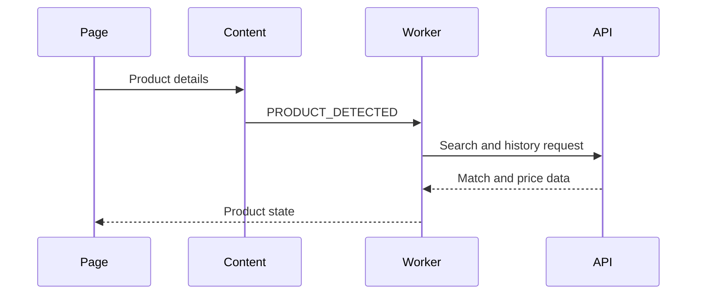

# Developer guide

The extension uses Manifest V3: `content/` detects and extracts product data, `stores/adapters.js` holds retailer-specific selectors, `background/` is the service worker, `utils/` contains matching, API, pricing, and state logic, and `popup/` renders the interface. The extension requests price comparisons from the hosted enComerciales HTTPS API.

To add a store, define its domain and selectors in `stores/adapters.js`, keep selectors scoped to that store, add a fixture, and verify name and price extraction. Generic extraction remains the fallback. Do not mark a fuzzy match as exact; matching identifiers such as GTIN or SKU provide stronger evidence.

Run the existing JavaScript test suite with `node --test tests/extension/*.test.mjs`. For manual browser testing, load `browser-extension/` as an unpacked extension, refresh a supported product page, and verify both history and no-history states.
