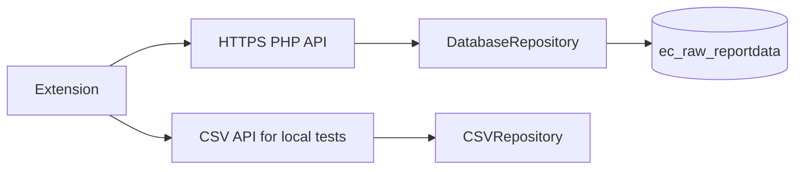

# Phase 1.1 audit

## Findings

The previous Phase 1 implementation was useful locally, but it had three integration blockers: the CSV API was the only repository, MV3 content scripts incorrectly used ES module imports, and `<all_urls>` made permissions broader than the supported retailer set. These are addressed in this phase. Content extraction is now an import-free runtime bundle, the manifest is restricted to the six supported domains plus configured API hosts, and a PHP production repository targets the real database.

The real application is the PHP site under `public_html`. `scripts/connect.php` calls `ec_db_connect()` using `config/ec_config.php`, which reads `EC_DB_HOST`, `EC_DB_NAME`, `EC_DB_USER`, and `EC_DB_PASSWORD` or its local configuration. Existing upload and reporting code confirms the table `ec_raw_reportdata` and columns `ptype`, `pname`, `plink`, `sale`, `price`, `date`, and `store`. Existing code already uses prepared statements for several reads/writes. No product master, UPC/SKU, source, or browser-observation table was found.

`price` is the current/discounted numeric value imported from `Precios`; `sale` is the regular/previous value imported from `Anterior`. The extension treats the existing rows as trusted scraper history. Browser observations remain separate JSONL development records and are not inserted into `ec_raw_reportdata`.

## Resulting architecture

The production repository uses bound parameters for values, aggregates in SQL, limits history rows, and returns generic errors to the browser. It requires an explicit `EC_PUBLIC_HTML` deployment path so it can reuse the existing connection implementation without knowing credentials.

The CSV development API now emits the same top-level intelligence contract (`product`, `match`, `current`, `statistics`, `rating`, `history`, and `stores`) as the PHP API, while retaining the older `stats` alias for the popup's development compatibility.

## Permissions review

* `storage`: saves the configured API URL, debug preference, and current-tab diagnostic data.
* No `tabs` or `activeTab` permission is needed: the popup reads the product snapshot stored by the content script, and page detection is limited by declared content-script matches.
* `http://localhost/*` and `http://127.0.0.1/*`: development API only.
* `https://encomerciales.com/*` and `https://www.encomerciales.com/*`: production API hosts.
* Content-script matches are limited to the six audited retailer domains. `<all_urls>` was removed; generic extraction is available only within those declared retailer pages until an optional-permission design is added.

## Remaining integration risks

The available environment has source/configuration and CSV data but no verified reachable MariaDB service, web server, or browser session. Therefore the PHP API has been syntax-reviewed but not live-connected here. A Windows/manual integration test is provided in `MANUAL_INTEGRATION_TEST.md`.
